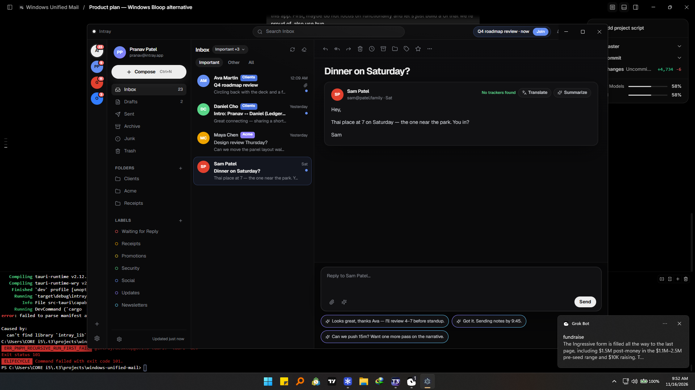

<p align="center">
  
</p>

<h1 align="center">Intray</h1>

<p align="center">
  <strong>All your inboxes in one place. Native fast. AI enabled.</strong><br>
  A Windows-first unified mail client — privacy by architecture, local/BYO AI, system tray triage, and built-in MCP.
</p>

<p align="center">
  <a href="#quick-start">Quick start</a>
  ·
  <a href="#desktop-app">Desktop</a>
  ·
  <a href="#marketing-site">Web</a>
  ·
  <a href="#contributing">Contributing</a>
  ·
  <a href="PRODUCT-PLAN.md">Product plan</a>
</p>

<p align="center">
  
</p>

---

## What is Intray?

Intray is an open-source **Windows unified mail client**. It connects Gmail, Outlook, iCloud, Yahoo, Fastmail, and other IMAP providers into one inbox on your PC. Mail stays on the device path to your providers — there is **no Intray mail relay**.

It is inspired by Mac-only clients like [Bloop](https://bloop.email/), built for Windows tray workflows, DPAPI-backed secrets, and agent tooling via MCP.

| Pillar | What it means |
| --- | --- |
| **Unified inbox** | Gmail (app password or OAuth) + IMAP/SMTP accounts in one UI |
| **Privacy by architecture** | Device ↔ provider only; credentials encrypted with Windows DPAPI |
| **Local / BYO AI** | OpenAI, Anthropic, Gemini, Grok CLI (`grok login`), Ollama, Claude Code, Codex, Cursor — secrets stay on this PC |
| **MCP** | Localhost tools so Cursor / Claude / Codex can search and read mail |
| **Tray-first** | System tray triage, notifications, optional start with Windows |

> **Status:** early development (v0.1). The UI runs with demo data until you connect an account. Expect breaking changes.

---

## Table of contents

- [Requirements](#requirements)
- [Repository layout](#repository-layout)
- [Quick start](#quick-start)
- [Desktop app](#desktop-app)
  - [Run in development](#run-in-development)
  - [Connect Gmail](#connect-gmail)
  - [Connect IMAP accounts](#connect-imap-accounts)
  - [AI providers](#ai-providers)
  - [MCP server](#mcp-server)
  - [Build a Windows installer](#build-a-windows-installer)
  - [Auto-updates (GitHub Releases)](#auto-updates-github-releases)
- [Marketing site](#marketing-site)
- [Scripts reference](#scripts-reference)
- [Architecture](#architecture)
- [Privacy model](#privacy-model)
- [Troubleshooting](#troubleshooting)
- [Contributing](#contributing)
- [Key contributors](#key-contributors)
- [Docs](#docs)
- [License](#license)

---

## Requirements

| Tool | Version | Notes |
| --- | --- | --- |
| **OS** | Windows 10 22H2+ | Windows 11 recommended for tray/toast polish |
| **[Bun](https://bun.sh)** | 1.3+ | Package manager and script runner for this monorepo |
| **[Rust](https://rustup.rs)** | stable (MSVC) | Builds `@intray/native` (mail SQLite store) |
| **Git** | recent | Clone and contribute |
| **Google Cloud project** | optional | Only for the Gmail “Sign in with Google” tester flow. App passwords do not need it |

Install Bun on Windows (PowerShell):

```powershell
powershell -c "irm bun.sh/install.ps1 | iex"
```

Confirm:

```powershell
bun --version
```

---

## Repository layout

This is a **Bun workspaces** monorepo:

```
windows-unified-mail/          # repo root (package name: intray)
├── apps/
│   ├── desktop/               # @intray/desktop — Electron + React mail client
│   │   ├── src/main/          # Node main process (mail façade, OAuth, MCP, tray)
│   │   ├── src/preload/       # contextBridge IPC surface
│   │   ├── src/renderer/      # React UI
│   │   ├── src/shared/        # shared types
│   │   ├── resources/         # app / tray icons
│   │   └── .env.example       # Optional Gmail OAuth template
│   └── web/                   # @intray/web — Next.js marketing site (Netlify)
├── crates/
│   └── intray-native/         # @intray/native — Rust SQLite + FTS5 (napi-rs)
├── assets/                    # brand mark, wordmark, icons
├── docs/                      # research brief + UI reference frames
├── PRODUCT-PLAN.md            # product + technical plan
├── Cargo.toml                 # Rust workspace
├── netlify.toml               # web deploy config
└── package.json               # workspace scripts
```

| Package | Path | Role |
| --- | --- | --- |
| `@intray/desktop` | [`apps/desktop`](apps/desktop) | Desktop mail app (Electron + React + TypeScript) |
| `@intray/native` | [`crates/intray-native`](crates/intray-native) | Rust mail store (SQLite WAL + FTS5) |
| `@intray/web` | [`apps/web`](apps/web) | Marketing site (Next.js → Netlify) |

---

## Quick start

From a clean machine to a running desktop window:

```powershell
git clone https://github.com/keithsimkin/intray-email-client.git
cd intray-email-client

bun install

# Desktop app — builds the Rust mail store, then launches Electron
# (demo inbox until you add a real account; requires rustup + MSVC)
bun run dev:desktop

# In another terminal — marketing site at http://localhost:3000
bun run dev:web
```

Without a connected account, the desktop UI still loads **demo data** so you can explore layouts and flows.

---

## Desktop app

### Run in development

```powershell
bun install
bun run dev:desktop
```

This runs `electron-vite dev` for `@intray/desktop`. Hot reload applies to the renderer; main-process changes usually require a restart.

Useful variants:

```powershell
# From the desktop package directly
cd apps/desktop
bun run dev

# Production-like local preview (build + open)
bun run preview

# Compile only (no installer)
bun run build
```

### Connect Gmail

Gmail has two sign-in paths. **App password over IMAP/SMTP is the default** and works for any account that can create app passwords — no Google Cloud project and no restricted-scope verification. **Sign in with Google** stays available for testers when `GMAIL_CLIENT_ID` is set. Both store secrets on this PC with Electron `safeStorage` (Windows DPAPI). Mail goes device ↔ Google. There is no Intray relay.

#### App password (recommended)

1. Turn on [2-Step Verification](https://myaccount.google.com/signinoptions/two-step-verification) for the Google account.
2. Create an app password at [myaccount.google.com/apppasswords](https://myaccount.google.com/apppasswords). Google shows 16 letters in four groups (`abcd efgh ijkl mnop`). Paste them with or without spaces — Intray strips the spaces.
3. In Gmail on the web: **Settings → See all settings → Forwarding and POP/IMAP → Enable IMAP**.
4. In Intray: **Add account → Gmail**. Enter the full Gmail address and the app password.

Servers (filled in for you; 587 STARTTLS works if you change the SMTP port):

| | Host | Port | Security |
| --- | --- | --- | --- |
| IMAP | `imap.gmail.com` | 993 | TLS |
| SMTP | `smtp.gmail.com` | 465 | TLS |

The username is the full email address. Do not use your normal Google password.

Some **Workspace, school, and Advanced Protection** accounts cannot create app passwords. If the button is missing, or Gmail returns an auth error after you paste a normal password, that account needs the OAuth tester flow below — or an admin has to allow app passwords / IMAP.

Intray reads Gmail’s special-use mailboxes (`All Mail`, `Sent`, `Drafts`, `Spam`, `Trash`, `Starred`, `Important`) and Gmail’s `X-GM-MSGID` / `X-GM-LABELS` / `X-GM-THRID` extensions. Sync follows **All Mail** plus Spam and Trash so the same message is not listed once per label.

#### Google sign-in (beta / testers)

OAuth uses restricted Gmail scopes, so Google only allows users you list as test users until the app passes verification. The button is hidden until a client id is configured, and it is labeled **Sign in with Google (beta / testers)**.

1. Open [Google Cloud Console](https://console.cloud.google.com/) → **APIs & Services**.
2. Create or select a project and enable the **Gmail API**.
3. **OAuth consent screen** → add yourself under **Test users**.
4. **Credentials** → **Create credentials** → **OAuth client ID** → type **Desktop app**.
5. Copy the client ID into `apps/desktop/.env`:

```powershell
cd apps/desktop
copy .env.example .env
# Edit .env and set:
# GMAIL_CLIENT_ID=your-client-id.apps.googleusercontent.com
```

Template ([`apps/desktop/.env.example`](apps/desktop/.env.example)):

```env
# Optional. App-password Gmail does not need this.
# Desktop OAuth client for "Sign in with Google (beta / testers)".
# Restricted Gmail scopes: only consent-screen test users can sign in
# until Google verifies the app. Enable the Gmail API on the project.
GMAIL_CLIENT_ID=
# Optional — only if your client is a Web application type
# GMAIL_CLIENT_SECRET=
```

6. Restart the desktop app (`bun run dev:desktop`).
7. **Add account → Gmail → Sign in with Google (beta / testers)** and finish the browser loopback flow.

> Never commit `.env`. It is gitignored. Only `.env.example` belongs in the repo.

### Connect IMAP accounts

For **Gmail, iCloud, Outlook.com, Yahoo, Fastmail, Zoho, AOL**, or any generic IMAP provider:

1. Create an **app password** (or IMAP password) in that provider’s security settings. Gmail’s steps are in [Connect Gmail](#connect-gmail).
2. In Intray: **Add account** → pick the provider (or custom IMAP).
3. Enter email + app password.

Credentials are encrypted with Windows DPAPI on this machine. Mail syncs provider ↔ app over TLS; nothing is uploaded to an Intray server.

### AI providers

**Settings → AI & agents** supports:

- OpenAI, Anthropic, Gemini (API keys)
- Grok via the local `grok` CLI (`grok login`) — same sign-in style as Cursor/T3; xAI API key remains a fallback
- Ollama (local)
- Claude Code, Codex, Cursor-oriented setups

API keys (when used) are encrypted with DPAPI. Mail content is sent only to the AI provider **you** configure — never through an Intray backend.

### MCP server

On launch, Intray can start a **localhost-only** MCP endpoint (default port **47821**):

```text
http://127.0.0.1:47821/mcp
```

Every request must carry a **per-install bearer token** (except `/health`). The token is generated on first run, encrypted at rest with DPAPI, and shown only inside **Settings → AI & agents**. Paste the ready-made snippet into your client:

```json
{
  "mcpServers": {
    "intray": {
      "url": "http://127.0.0.1:47821/mcp",
      "headers": { "Authorization": "Bearer <your-token>" }
    }
  }
}
```

Built-in tools:

| Tool | Purpose |
| --- | --- |
| `search_emails` | Search local mail by query |
| `read_thread` | Read a message/thread by id |
| `list_accounts` | List connected accounts on this device |

Toggle MCP under **Settings → AI & agents**, and use **Rotate access token** to invalidate existing clients.

Hardening: the listener binds to `127.0.0.1` only; requests with an `Origin` or `Sec-Fetch-Mode` header (i.e. browser pages) are rejected before auth; `Host` is validated; CORS is not granted; bodies are capped at 1 MB and tool arguments are clamped. If the default port is taken, Intray falls back to an ephemeral port and shows the new URL in Settings.

### Build a Windows installer

```powershell
cd apps/desktop
bun run pack
```

From the repo root, `bun run pack:desktop` builds the native mail store, then the app, then the installer. Output is `apps/desktop/release/Intray-Setup-0.1.0.exe`.

The installer is an assisted NSIS setup: current user or all users, a chosen folder, Start menu and desktop shortcuts, and the GPL license. Uninstall leaves downloaded mail and keys in the user profile. The executable is unsigned until a code-signing certificate is added.

App id: `app.intray.desktop` · Product name: **Intray**.

### Auto-updates (GitHub Releases)

Installed builds use [`electron-updater`](https://www.electron.build/auto-update) to poll [GitHub Releases](https://github.com/keithsimkin/intray-email-client/releases). On launch they check for a newer version, download it in the background, then prompt to restart (also under **Settings → About**). Dev / `electron-vite` sessions skip the updater.

`bun run pack` / `pack:desktop` still use `--publish never` so local builds never upload. Publishing a release (needs a `GH_TOKEN` with `repo` scope):

```powershell
# bump apps/desktop/package.json version first
cd apps/desktop
bun run release
```

That uploads the NSIS installer plus `latest.yml` (required by the updater). Manual uploads must include both artifacts on the same release.

---

## Marketing site

The landing page lives in [`apps/web`](apps/web) (Next.js). Netlify build settings are in [`netlify.toml`](netlify.toml) (`base = apps/web`).

```powershell
bun run dev:web
# → http://localhost:3000

bun run build:web
```

From the web package:

```powershell
cd apps/web
bun run dev
bun run build
bun run lint
```

---

## Scripts reference

From the **repo root** (`package.json`):

| Script | What it does |
| --- | --- |
| `bun install` | Install all workspace dependencies |
| `bun run dev:desktop` | Electron app in development |
| `bun run dev:web` | Next.js marketing site |
| `bun run build:native` | Build the Rust `@intray/native` napi addon |
| `bun run build:desktop` | Build native + desktop renderer/main bundles |
| `bun run build:web` | Production build of the marketing site |
| `bun run pack:desktop` | Build native + NSIS installer (`--publish never`) |
| `bun run release:desktop` | Build + publish installer to GitHub Releases |

Desktop-only (`apps/desktop`):

| Script | What it does |
| --- | --- |
| `bun run dev` | `electron-vite dev` |
| `bun run build` | `electron-vite build` |
| `bun run preview` | Preview the built app |
| `bun run pack` | Build + assisted NSIS Windows installer (no upload) |
| `bun run release` | Build + publish to GitHub Releases (`GH_TOKEN` required) |

---

## Architecture

```text
Mail providers (Gmail API / IMAP+SMTP)
        │ TLS
        ▼
┌─────────────────────────────────────┐
│ Intray Desktop (Electron)           │
│  React UI + tray                    │
│  Node sync / OAuth / IMAP / MCP     │
│  DPAPI safeStorage · AI router      │
│         │ napi-rs                   │
│  Rust mail store · SQLite + FTS5    │
└─────────────────────────────────────┘
        │                    │
        ▼                    ▼
  Ollama / BYO keys    Cursor / Claude / Codex
```

Same approach Discord used before Project Phoenix: keep the Electron shell, move hot stores into Rust.

**Process boundaries** (follow these when contributing):

| Layer | Path | Responsibility |
| --- | --- | --- |
| **Main** | `apps/desktop/src/main/` | Windows, tray, OAuth, IMAP, typed DB façade, credentials, AI secrets, MCP, notifications |
| **Native** | `crates/intray-native/` | SQLite WAL + FTS5 mail cache (`MailDb` via napi-rs) |
| **Preload** | `apps/desktop/src/preload/` | Thin `contextBridge` — typed IPC only, no business logic |
| **Renderer** | `apps/desktop/src/renderer/` | React UI |
| **Shared** | `apps/desktop/src/shared/` | Types shared across processes |

Hard rules:

- Secrets and API keys live in **main** only (DPAPI via `safeStorage`).
- Do not put mail credentials or AI keys in the renderer, logs, or URLs.
- Prefer extending preload with a minimal typed method over widening Node access in the UI.

---

See [SECURITY.md](SECURITY.md) for the threat model and how to report issues.

## Privacy model

- Mail bodies and headers leave the machine only to **your** mail provider or **your** chosen AI endpoint.
- App passwords and OAuth tokens are encrypted with **Windows DPAPI** (`Electron safeStorage`).
- SMTP uses STARTTLS on submission ports (465 is implicit TLS) with TLS 1.2+; IMAP requires TLS.
- Outbound mail is built by an RFC 5322 builder in the main process — the renderer never supplies raw headers.
- Inbound HTML is sanitized in the main process. Remote images follow **Settings → Privacy → Remote images** (never / always / trusted senders); the default is never, with per-message Load images. Links open through a validated allowlist (`http`, `https`, `mailto`).
- MCP listens on **127.0.0.1** only, requires a per-install bearer token, and rejects browser requests.
- The app window blocks in-page navigation and denies permission requests it does not need.
- Crash/analytics are off by default (product plan); do not add phone-home without an explicit, documented opt-in.
- License checks (when added) are key-only — never mail content.

See [`SECURITY.md`](SECURITY.md) for the threat model and how to report issues.

---

## Troubleshooting

| Symptom | What to try |
| --- | --- |
| Gmail says the password is not an app password | Turn on 2-Step Verification and paste the 16-letter app password from [myaccount.google.com/apppasswords](https://myaccount.google.com/apppasswords), not your normal Google password |
| Gmail rejects the app password, or asks you to sign in with a browser | Enable IMAP in Gmail → Settings → Forwarding and POP/IMAP. Workspace, school, and Advanced Protection accounts often block app passwords |
| `GMAIL_CLIENT_ID is not set` | Expected for app-password Gmail. Set it only if you want **Sign in with Google (beta / testers)** |
| OAuth browser flow fails | Confirm the Gmail API is enabled, the client type is **Desktop app**, your account is a consent-screen test user, and you are not setting `GMAIL_CLIENT_SECRET` unless the client is a Web application |
| App opens with only demo mail | Expected until an account is added — use **Add account** |
| MCP tools unreachable | Check Settings → AI & agents that MCP is enabled; use the URL and bearer token shown there |
| MCP returns `401 Unauthorized` | The client is missing or has an old token — copy the current snippet from Settings, or rotate the token |
| Remote images blocked | Expected default (**Never download**) — choose **Load images**, or set Always / Trusted sources in Settings → Privacy |
| `bun install` fails | Use Bun 1.3+; delete `node_modules` and retry from repo root |
| Native addon missing / `Cannot find module @intray/native` | Install Rust (MSVC), then `bun run build:native` |
| DPAPI / encryption errors | Run on a normal Windows user session (encryption needs OS secure storage) |

---

## Contributing

Contributions are welcome — code, docs, bug reports, and UX polish. Newcomers and non-code contributions are encouraged.

**Short path:**

1. Fork the repo and create a branch from `master`.
2. `bun install` at the repo root.
3. Make a focused change (one concern per PR).
4. Run the relevant app (`bun run dev:desktop` or `bun run dev:web`) and verify manually.
5. Open a pull request with a clear description of **why** and how you tested.

Please read **[CONTRIBUTING.md](CONTRIBUTING.md)** for project structure, coding conventions, PR checklist, and issue guidance.

### Good first contributions

- Fix typos / clarify docs and README steps
- Improve empty states and error copy in the renderer
- IMAP provider presets and onboarding hints
- Accessibility and keyboard shortcuts
- Marketing site content and performance

Use GitHub Issues for bugs and proposals. Prefer a small reproduction or screenshot for UI bugs.

### Key contributors

| Name | Role | Links |
| --- | --- | --- |
| [Keith Simkin](https://github.com/keithsimkin) | Creator / maintainer | [Twitter / X](https://x.com/Ctrlthenarative) (`@Ctrlthenarative`) |

---

### Key contributors

| Name | Role | Links |
| --- | --- | --- |
| [Keith Simkin](https://github.com/keithsimkin) | Creator / maintainer | [Twitter / X](https://x.com/Ctrlthenarative) (`@Ctrlthenarative`) |

---

## Docs

| Document | Contents |
| --- | --- |
| [PRODUCT-PLAN.md](PRODUCT-PLAN.md) | Product pillars, architecture, phased delivery |
| [docs/BLOOP-RESEARCH-BRIEF.md](docs/BLOOP-RESEARCH-BRIEF.md) | Competitive / research brief |
| [docs/ui-ref/](docs/ui-ref/) | UI reference frames and screenshots |
| [SECURITY.md](SECURITY.md) | Threat model and vulnerability reporting |
| [CONTRIBUTING.md](CONTRIBUTING.md) | How to develop and submit changes |
| [apps/desktop/.env.example](apps/desktop/.env.example) | Optional Gmail OAuth env template |

---

## License

Intray is licensed under the **[GNU General Public License v3.0 or later](LICENSE)**, with additional attribution terms.

In plain terms:

- You are free to use, study, modify, and share Intray.
- If you **redistribute** it (original or modified), you must keep it **open source** under GPL-3.0-or-later and provide corresponding source as the GPL requires.
- You must **give credit to Intray** — name it as “Intray” or “based on Intray” in your README (or equivalent) and about/credits UI, and keep copyright notices intact.
- Modified versions must be marked as modified and must not claim to be the official Intray release.

See [`LICENSE`](LICENSE) for the full legal text and [`NOTICE`](NOTICE) for the short attribution summary.

---

<p align="center">
  
</p>
